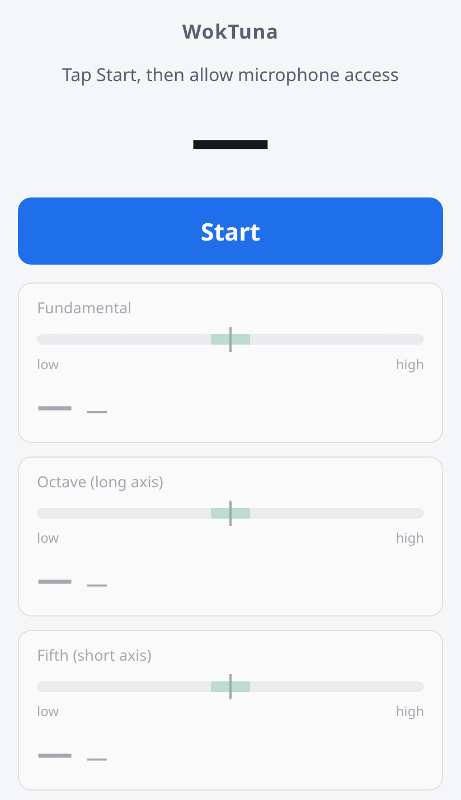

# WokTuna

**Live demo:** https://avataristvan.github.io/woktuna/ (needs microphone access)

<p align="center">
  <picture>
    <source media="(prefers-color-scheme: dark)" srcset=".github/assets/screenshot-dark.png">
    
  </picture>
</p>

## The problem

Tuning a handpan means hammering a dished steel tone field until it rings
true. Each tone field resonates at three partials at the same time:

- the **fundamental**, set mainly at the center (dimple) of the field,
- the **octave**, along the field's **long axis**,
- the **compound fifth** (twelfth), along its **short axis**.

General-purpose tuners show a frequency or a cent deviation. That tells you
_that_ a note is off. It does not tell you _where_ to hammer or _along which
axis_, and that is what a tuner actually has to work out.

## What WokTuna does

WokTuna is an installable PWA. It listens through the microphone, detects
the fundamental and the octave / compound-fifth partials live, and turns the
deviations into hammering guidance:

- **Position:** center ↔ edge for the fundamental (hammering near the
  center raises the pitch, near the edge lowers it).
- **Axis:** long axis for the octave, short axis for the compound fifth,
  each with its own deviation and direction.
- **Target note:** resolved chromatically, so the nearest equal-tempered note
  becomes the target. The lock is sticky, so a decaying note or bleed from a
  neighboring field doesn't make the target jump.
- **Settings:** reference pitch (A4, default 440 Hz), the partial search
  tolerance, inside/outside hammering, and an optional spectrum view.

When no note is sounding, the last reading is shown dimmed. The app never
displays made-up "in tune" values.

## Architecture

TypeScript + Vite, no UI framework. The code is organized by capability
(domain-driven design), and dependencies point inward:

```
domain ← application ← infrastructure / presentation ← app (composition root)
```

```
src/
  app/                          # wires adapters → use cases → presentation
  shared-kernel/                # shared vocabulary (partial kinds, axis mapping, ratios)
  capabilities/
    tone-field-detection/       # autocorrelation (fundamental) + FFT peak-picking (partials)
    scale-configuration/        # note ↔ frequency, chromatic target resolution
    tone-field-visualization/   # deviation → guidance mapping, Canvas rendering
```

`domain/` has no dependency on Web Audio, Canvas or the DOM. That keeps
the tuning rules testable on their own, against synthetic signals.

A few DSP details worth knowing:

- The fundamental comes from autocorrelation over a 4096-sample window,
  refined by parabolic interpolation, with DC and rumble removed first.
- The octave and compound fifth come from FFT peak-picking over a 16384-sample
  frame. A candidate peak only counts if it is a local maximum _and_ stands
  clearly above the local noise floor just outside its search band. This
  avoids confident false readings on noise.
- The analysis is budgeted to fit the 60 fps render loop.

## Getting started

Requires Node.js 20.19+ or 22.12+.

```sh
npm install
npm run dev         # dev server
npm run test        # unit tests (Vitest)
npm run build       # typecheck + production build
npm run preview     # serve the production build
npm run lint
```

The service worker registers only in production builds.

## Status and limitations

This is a working prototype, **not yet validated on a real instrument.** Be
aware of the following before relying on it:

- **No real-hardware test yet.** The detection pipeline has only been tested
  against synthetic signals. It still has to be checked with a real handpan
  and a real microphone.
- **Tunable constants are unverified.** The ±250-cent partial search window
  and the 175-cent threshold for re-locking the target are starting values.
  With a window that is too narrow, badly detuned partials are missed; with
  one that is too wide, the detector can lock onto a neighboring tone field's
  resonance (crosstalk), which is an open question.
- **Inside/outside hammering:** the inversion of center/edge guidance for
  hammering from the inside is based on a single source and is unverified.
- **Reference pitch:** there is no confirmed standard for handpans
  (440 vs. 442/443 Hz), so it stays user-configurable.

## Background

- [Research notes (German)](handpan-stimm-app-recherche.md): tone-field
  physics, the partial/axis relationship, and a survey of existing tuners.
- [`docs/`](docs/): design decisions and development records from building
  the app.

## License

[MIT](LICENSE)
